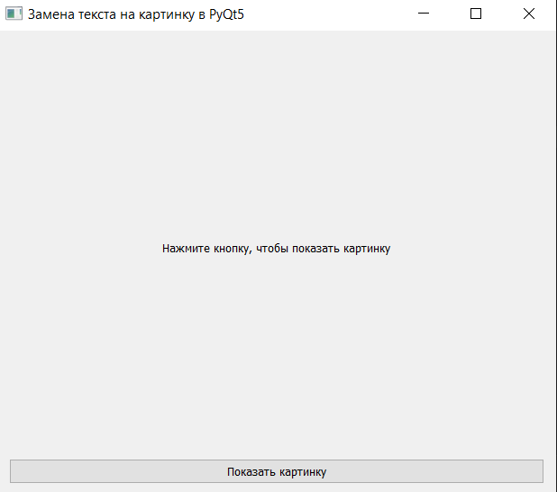
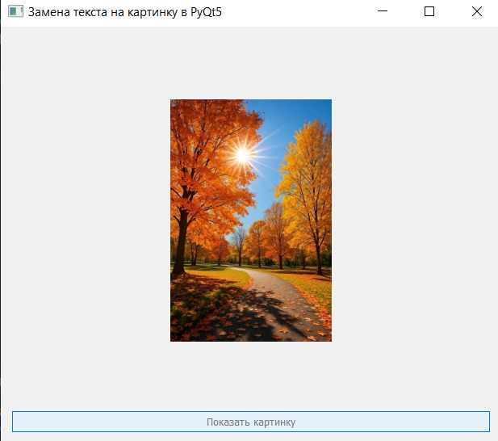

## Архитектура программы состоит из следующих уровней и компонентов:

- Главный класс приложения `(ImageSwitcherApp)`:
Наследуется от базового графического виджета `QWidget`, выступая в роли контейнера для всех элементов интерфейса (окна). Он инкапсулирует в себе состояние окна, визуальные элементы и логику их взаимодействия.

- Иерархия виджетов:

1. `QVBoxLayout`: Отвечает за вертикальное расположение элементов (надпись сверху, кнопка снизу) и их автоматическое масштабирование при изменении размера окна.

2. `QLabel`: Универсальный элемент, способный отображать как текстовую строку, так и графический объект `(QPixmap)`.

3. `QPushButton`: Интерактивный элемент интерфейса, принимающий пользовательский ввод.

## Результат работы программы:

# Первый запуск: 

# После нажатия на кнопку:

