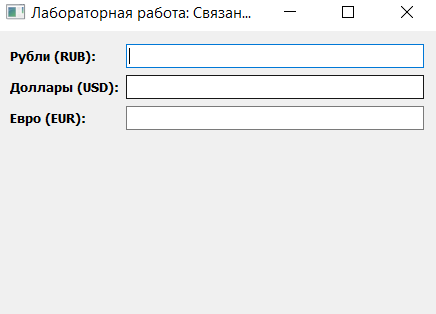
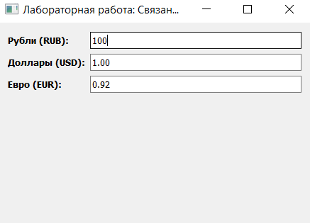
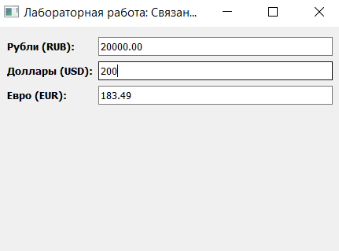
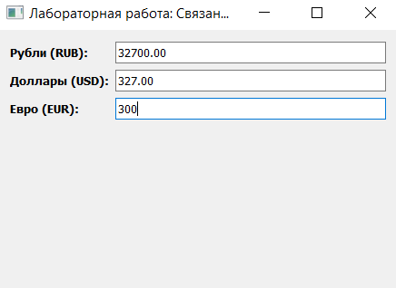

## Архитектура программы

- Главный класс `(CurrencyConverterApp)`:
Наследуется от `QWidget` и инкапсулирует в себе интерфейс приложения, состояние полей и всю расчетную бизнес-логику конвертации валют.

- Компоненты интерфейса (View):

1. `QFormLayout`: Двухколоночный менеджер компоновки, где слева располагаются текстовые метки `(QLabel)` с названиями валют, а справа — поля ввода `(QLineEdit)`.

2. `QLineEdit` (Поля ввода): Три интерактивных элемента, позволяющие пользователю не только видеть данные, но и редактировать их с клавиатуры в реальном времени.

3. Механизм защиты от зацикливания `(Guard Variable)`:
Специальный флаг состояния `(self.updating)`, предотвращающий бесконечную рекурсию сигналов при двусторонней связи.

## Результат работы программы:

# Первый запуск:

# Ввод рублевый валюты:

# Ввод долларовой валюты:

# Ввод евро валюты:

