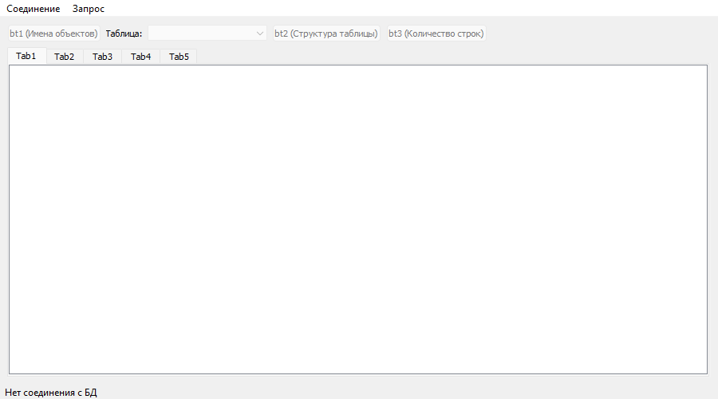
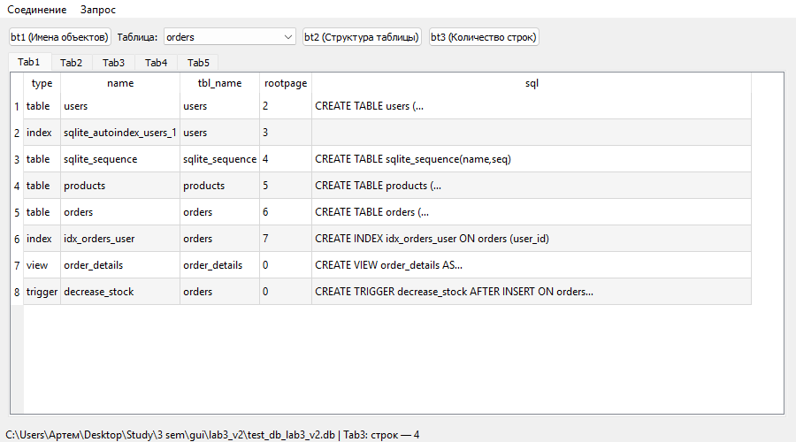
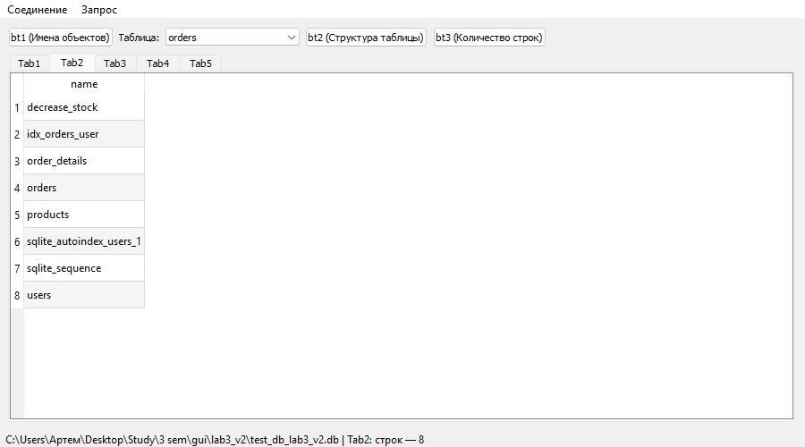
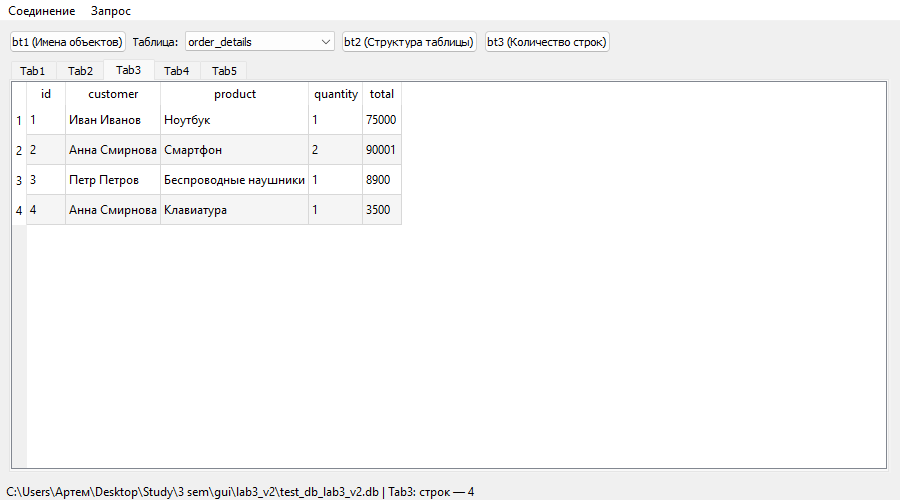
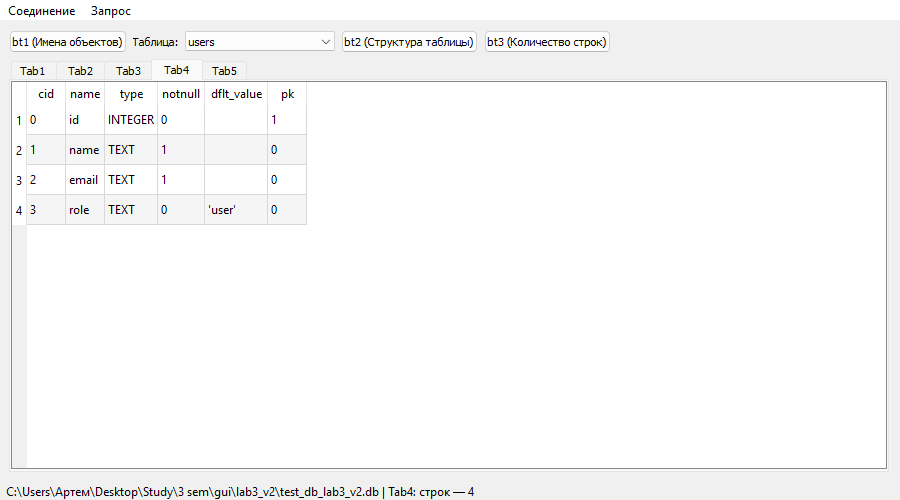
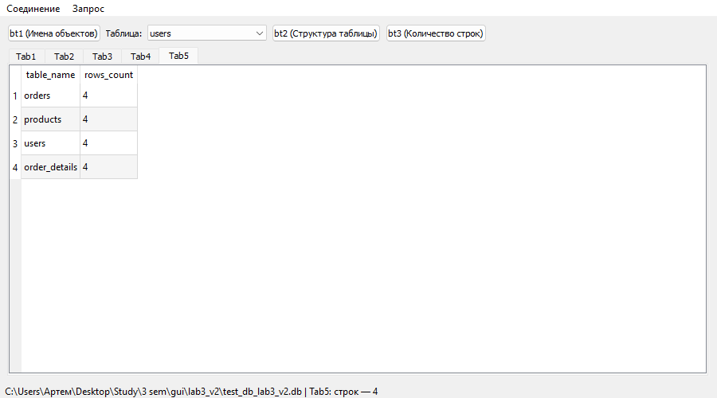
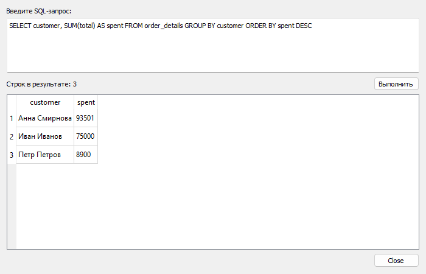
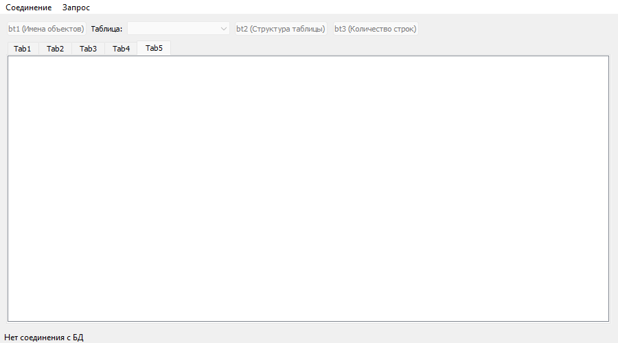

## Лабораторная работа № 3
## Бельдинова Мария Сергеевна
## Группа 6233-010402D

### Архитектура и принцип работы

Приложение представляет собой графический интерфейс для визуализации данных базы данных SQLite.

**Модули:**

`db_window.py`: главный класс `DbWindow` — меню, панель управления и вкладки.

`db_helper.py`: класс `DbHelper` — создание тестовой базы данных `test_db_lab3.db`
и безопасная очистка моделей перед закрытием соединения.

`query_dialog.py`: класс `QueryDialog` — модальное окно для произвольного SQL-запроса (бонусное задание).

**Логика работы:**

`QSqlDataBase`: Отвечает за установку, поддержание и закрытие именованного соединения `lab3_connection` с файлом базы данных SQLite.

`QSqlQueryModel`: У каждой вкладки своя модель, созданная один раз при запуске окна. Запросы только меняют её содержимое.

`QTableView`: Виджет, который отображает данные из модели в виде интерактивной таблицы.

1. При вызове *Set connection* пользователь через `QFileDialog` выбирает файл `.db`. Диалог сразу открывается в папке с тестовой БД.
2. Приложение открывает соединение и выполняет запрос для `Tab1`. Если файл не является базой данных, соединение закрывается и выводится ошибка.
3. Названия таблиц и представлений считываются из служебной таблицы *sqlite_master* и попадают в `QComboBox`.
4. По нажатию кнопок `(bt1, bt2, bt3)` или при смене пункта в `QComboBox` формируются SQL-запросы, результаты которых передаются соответствующим вкладкам `QTabWidget`.
5. В строке состояния выводится путь к БД и количество строк в последнем результате.
6. При вызове *Close connection* (или закрытии окна) модели всех вкладок очищаются, а соединение с БД закрывается.

**Отличия от первой версии:**

- Путь к тестовой БД не зависит от папки, из которой запущена программа.
- В тестовой БД появились индекс, представление `order_details` и триггер `decrease_stock`.
- `bt2` показывает структуру выбранной таблицы, `bt3` — количество записей во всех таблицах.
- Добавлено модальное окно для произвольного запроса (меню *Запрос → SQL-запрос...*, `Ctrl+E`).
- Исправлено падение при повторном подключении к БД: после `QSqlQueryModel.clear()` модель
сохраняет ссылку на драйвер закрытого соединения, поэтому `DbHelper.release_model()`
дополнительно привязывает её к пустому `QSqlQuery()`.

**Результат работы программы:**

Запуск программы

После успешного соединения появляется `MessageBox` с уведомлением, иначе выдаст ошибку.

`Tab1`: Автоматически заполняется при подключении запросом
`SELECT * FROM sqlite_master.`

`Tab2`: Кнопка `bt1` отправляет выборочный запрос
`SELECT name FROM sqlite_master ORDER BY name.`

`Tab3`: При выборе любой таблицы в `QComboBox` отправляется запрос `SELECT * FROM "<выбранная_таблица>".`

`Tab4`: Кнопка `bt2` выводит структуру выбранной таблицы `PRAGMA table_info("<выбранная_таблица>").`

`Tab5`: Кнопка `bt3` выводит количество записей в каждой таблице. Запрос собирается
динамически из списка таблиц:
`SELECT 'users' AS table_name, COUNT(*) AS rows_count FROM "users" UNION ALL ...`

Модальное окно для произвольного SQL-запроса

Закрываем соединение — интерфейс очищается

