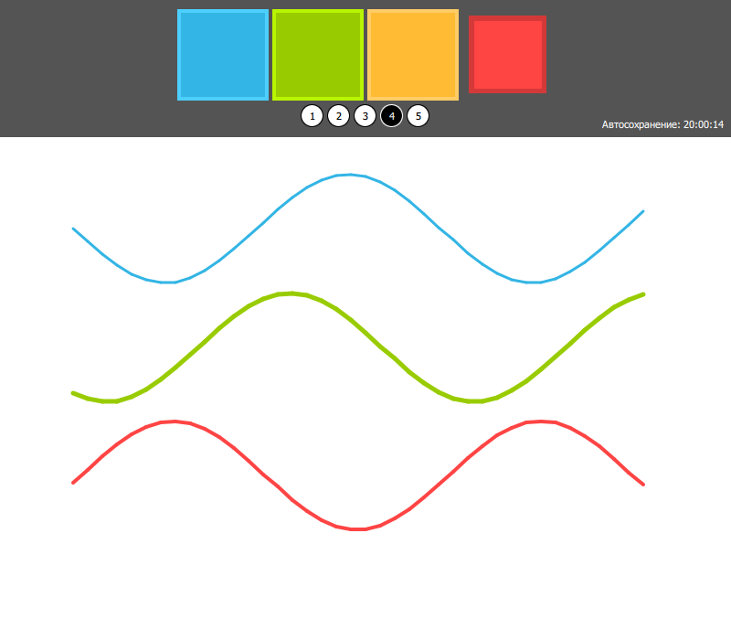
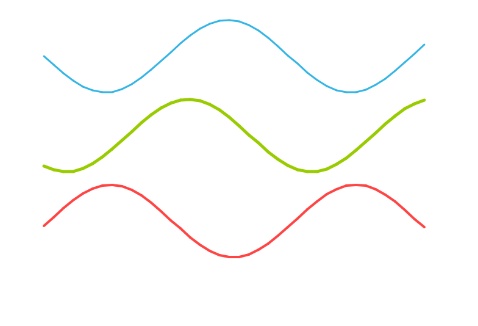

## Лабораторная работа № 4
## Бельдинова Мария Сергеевна
## Группа 6233-010402D

### Архитектура и принцип работы

`Frontend`: Отвечает за графический интерфейс пользователя (UI), выбор цвета и толщины кисти `(Square.qml, Circle.qml)`, а также непосредственно область рисования (`Canvas` в `mainWindow.qml`).

`Backend`: Класс `Interface` в модуле `interface.py`. Инициализирует фоновый таймер `(QTimer)`, отслеживает изменения рисунка и инициирует сохранение графической области `Canvas` на диск.

Для связи компонентов используется контекстное свойство *rootContext().setContextProperty()*:

```python
interface = Interface(engine)
engine.rootContext().setContextProperty("_backend", interface)
```

Связь работает в обе стороны:

1. **QML → Python**: после каждой нарисованной линии `Canvas` вызывает слот *_backend.markDirty()*, который выставляет флаг несохраненных изменений.

2. **Python → QML**: с помощью *root.findChild(QObject, "canvas")* находится холст, и через *QMetaObject.invokeMethod(...)* вызывается JS-функция `saveCanvas(filePath)`. Функция возвращает результат `canvas.save()`, поэтому Python знает, удалось ли сохранение:

```python
result = QMetaObject.invokeMethod(
    canvas,
    "saveCanvas",
    Q_RETURN_ARG(QVariant),
    Q_ARG(QVariant, self.save_path)
)
```

3. **Python → QML (сигнал)**: после сохранения испускается сигнал `saved(path, time)`, а QML через `Connections` выводит время последнего сохранения на панели инструментов.

## Логика работы `Canvas`:

- Обработка пользовательского ввода происходит через *MouseArea*. При перемещении курсора вызывается *canvas.requestPaint().*

- В обработчике *onPaint* с помощью 2D-контекста `(getContext("2d"))` вычерчиваются сглаженные линии заданной толщины и цвета.

- При первой отрисовке холст заливается белым цветом, чтобы в сохраненном файле не было прозрачного фона (свойство `isInitialized` объявлено в `Canvas`).

- Линия рисуется только при зажатой кнопке мыши: Qt вызывает *onPaint* и сам (например, при изменении размера окна), и без этой проверки на холсте появлялись бы лишние точки.

## Фоновое сохранение по `QTimer`:

В классе `Interface` инициализирован объект `QTimer`:

```python
self.timer = QTimer(self)
self.timer.setInterval(interval_ms)  # по умолчанию 5000 мс
self.timer.timeout.connect(self.autosave)
self.timer.start()
```

*Принцип работы*: Каждые 5000 мс (5 секунд) срабатывает сигнал timeout, вызывающий слот *autosave()*. Если с прошлого сохранения рисунок не менялся, запись на диск пропускается.

*Результат*: Рисунок сохраняется в файл `lab4/saved_canvas.png` (путь не зависит от папки запуска).
Перед выходом из программы (`aboutToQuit`) таймер останавливается и выполняется последнее сохранение, если остались несохраненные изменения.

**Результат работы программы**



Сохраненный файл `saved_canvas.png`:



Логирование таймера:

```
[Backend] 20:00:12 автосохранение выполнено: ...\lab4\saved_canvas.png
[Backend] 20:00:13 автосохранение выполнено: ...\lab4\saved_canvas.png
[Backend] 20:00:14 автосохранение выполнено: ...\lab4\saved_canvas.png
[System] Переменные окружения успешно очищены!
```
